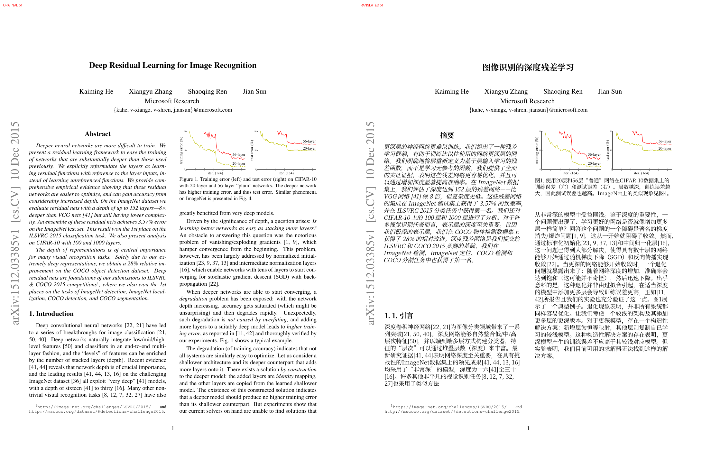

# pdf-translate

English | [简体中文](README.zh-CN.md)

[](LICENSE)
[](https://www.rust-lang.org/)
[](#build-from-source)

**A layout-preserving PDF paper translator written in Rust.** One binary — no Python, no BabelDOC, no external PDF
tools.

`pdf-translate` rewrites the body text of digital-born academic papers in another language while keeping figures,
tables, formulas, headers and footers where they were. It extracts glyphs, fonts, colors, images and positions,
reconstructs lines, paragraphs and columns, translates paragraph by paragraph through any OpenAI-compatible API, and
typesets the result with an embedded CJK font.

The current release is a CLI (`inspect` and `translate`) plus a Zotero 7+ plugin that calls the CLI. The CLI can write
a translated-only PDF or a side-by-side bilingual PDF; a GUI and local HTTP server are still planned.



*Deep Residual Learning for Image Recognition — original page (left) and Chinese translation (right). Figures,
equations, captions and page geometry stay in place.*

## Highlights

- **Clean composition, not a cover-up overlay** — the default `clean` mode removes the original glyphs that were
  successfully replaced and paints the translation in their place. Figures, table rules, formulas and untranslated text
  remain original vector content; no full-page screenshot is embedded.
- **Formula-aware** — display equations are detected and protected; inline formulas are preserved as independent vector
  paths through `<fN>` placeholders, so subscripts, superscripts and math layout survive.
- **Paragraph-level translation** — any OpenAI-compatible chat endpoint works (OpenAI, DeepSeek, GLM, Qwen, Ollama,
  vLLM, ...). Paragraphs are translated concurrently, truncated replies are retried, and results are cached on disk
  across runs.
- **CJK typesetting** — Noto Serif CJK SC is subsetted and embedded into the output, with ToUnicode maps, CJK line
  breaking, punctuation rules, basic justification and per-paragraph font-size fitting.
- **Single binary** — fonts are zstd-compressed into the executable by default; no Python environment, external
  converter or system font is required.
- **Defensive defaults** — preflight checks cap input size, decompressed streams and image dimensions; signed PDFs are
  rejected instead of silently invalidated.

## How it works

```text
 PDF ──▶ extract ──▶ layout ──▶ translate ──▶ typeset ──▶ compose ──▶ PDF
          │           │            │            │           │
        glyphs      lines /      OpenAI-      CJK         clean: delete
        fonts       paragraphs   compatible   wrapping    replaced glyphs
        images      columns      API + cache  fitting     overlay: cover
        colors      formulas                              and redraw
```

The default pipeline is:

1. **Extract** glyphs, font metadata, colors, images, clipping and transforms
   with [hayro](https://crates.io/crates/hayro).
2. **Analyze** lines, paragraphs, columns, headings, formulas, footnotes, headers/footers and references with geometric
   heuristics.
3. **Translate** each paragraph via `/chat/completions`, preserving citations, numbers, URLs and `<fN>` / `<b>` / `<i>`
   markers. Results are cached in `$XDG_CACHE_HOME/pdf-translate/translations.json` (or
   `~/.cache/pdf-translate/translations.json`).
4. **Typeset** the translation with a subset of Noto Serif CJK SC: wrap, justify, shrink to fit, and fall back to the
   original when it cannot fit safely.
5. **Compose** a new page: `clean` removes only the replaced glyphs, while `overlay` paints background patches over the
   original and draws the translation on top.

## Requirements

- Rust 1.99.1+ (edition 2024) to build from source.
- An OpenAI-compatible chat-completions endpoint. A loopback endpoint (Ollama, vLLM, LM Studio, ...) works without an
  API key; remote endpoints need `[api].api_key`, `--api-key` or `OPENAI_API_KEY`.
- A digital-born PDF with extractable text. Scanned PDFs are not supported yet (no OCR).

## Build from source

```bash
cargo build --release
# binary: target/release/pdf-translate
```

The default build embeds a zstd-compressed Noto Serif CJK SC Regular face (roughly a 30 MB binary). Bold text uses
synthetic bold by default. To embed a real bold face (roughly 48 MB):

```bash
cargo build --release --features embedded-bold-font
```

To use system fonts and get a smaller binary, disable the default `embedded-fonts` feature:

```bash
cargo build --release --no-default-features
```

In that configuration, `fontdb` reads the platform font database (fontconfig on Linux, system font directories on
Windows/macOS), prefers the configured generic serif/sans faces, then common CJK families, and only accepts a candidate
that actually contains Chinese glyphs. A sibling bold face (for example `*-Bold.ttc`) is used for bold when available.

In every configuration, `[typeset].font` / `[typeset].bold_font` or `--font` / `--bold-font` override the defaults.
Fonts are licensed under the SIL Open Font License 1.1; see [`assets/fonts/LICENSE`](assets/fonts/LICENSE).

## Quick start

Create `~/.config/pdf-translate/config.toml` (Linux/macOS) or `%APPDATA%\pdf-translate\config.toml` (Windows):

```toml
[api]
base_url = "https://api.openai.com/v1"
# api_key = "sk-..."          # or set OPENAI_API_KEY
model = "gpt-4o-mini"
max_tokens = 4096
temperature = 0.2
timeout_secs = 180

[translation]
target_lang = "zh-CN"
concurrency = 6

[typeset]
# font = "/path/to/NotoSerifCJK-Regular.ttc"
# bold_font = "/path/to/NotoSerifCJK-Bold.ttc"
min_scale = 0.72
max_expand = 1.45
line_height = 1.22
```

Then translate a paper:

```bash
pdf-translate translate paper.pdf
# writes paper.zh.pdf next to the input
```

Or override the API for one run:

```bash
pdf-translate translate paper.pdf \
  --api-base https://api.deepseek.com/v1 \
  --api-key "$DEEPSEEK_API_KEY" \
  --model deepseek-chat \
  -o paper.zh.pdf
```

Preview the layout without calling a model:

```bash
pdf-translate translate paper.pdf --fake -o paper.preview.pdf
```

Translate only selected pages:

```bash
pdf-translate translate paper.pdf --pages 2-5,8 -o paper.zh.pdf
```

Inspect the extracted layout as JSON:

```bash
pdf-translate inspect paper.pdf --pages 1-2 -o layout.json
```

The JSON contains each page's lines, paragraphs, bounding boxes, fonts, formula markers and `protected` flags — useful
for debugging layout decisions. Omit `-o` to print it to stdout; add `--compact` for compact JSON.

## Configuration

Settings that do not depend on the document live in a global TOML file:

- Linux/macOS: `$XDG_CONFIG_HOME/pdf-translate/config.toml` (default `~/.config/pdf-translate/config.toml`)
- Windows: `%APPDATA%\pdf-translate\config.toml`

Use `--config PATH` or `PDF_TRANSLATE_CONFIG` to select another file. A missing default file means built-in defaults; an
explicitly selected file that does not exist is an error. Unknown keys are rejected.

Precedence: command-line flags > config file > `OPENAI_BASE_URL` / `OPENAI_API_KEY` / `OPENAI_MODEL` > built-in
defaults.

Path, page range, overlay mode, annotation handling and other document-specific choices stay on the command line.

## CLI reference

```text
pdf-translate inspect <input.pdf> [--pages 1-] [-o layout.json] [--compact]
pdf-translate translate <input.pdf> [-o output.pdf] [options]
```

| Option                   | Description                                           |
|--------------------------|-------------------------------------------------------|
| `-o, --output PATH`      | Output PDF (default: `<input stem>.zh.pdf`)           |
| `--pages 1-3,5`          | Pages to process (1-based, default `1-`)              |
| `--limit N`              | Translate at most N paragraphs (debugging)            |
| `--overlay`              | Overlay mode; default is clean                        |
| `--bilingual`            | Write a side-by-side bilingual PDF (original left, translation right) |
| `--no-cover`             | Overlay mode: do not paint background patches         |
| `--keep-annotations`     | Keep link/annotation rectangles on translated pages   |
| `--translate-references` | Translate the reference list too (skipped by default) |
| `--dump-layout PATH`     | Write layout and translations as JSON                 |
| `--fake`                 | No network; prefix every paragraph with `[译]`        |
| `--debug-boxes`          | Draw paragraph bounding boxes                         |

The following options override config defaults: `--target-lang`, `--concurrency`, `--font`, `--bold-font`,
`--min-scale`, `--max-expand`, `--line-height`, `--api-base`, `--api-key`, `--model`.

Input, output PDF and layout JSON must be different files. A real-model cache key includes the endpoint, model, target
language and source text; entries from versions that could not detect truncation are re-requested.

## Clean vs. overlay

The default is `clean`:

- removes the glyphs that were successfully replaced from the content stream;
- clears their `ActualText` / `Alt` entries and drops content streams and Form XObjects that lose all references;
- keeps figures, table rules, references, protected formulas and any paragraph that could not be typeset as original
  vector content;
- does **not** embed a page snapshot;
- errors out when a page cannot be rewritten safely instead of silently falling back to overlay.

`--overlay` keeps the original content stream, covers it with background patches, and draws the translation on top. It
retains the covered source text underneath, so it is the fallback for scans and for pages where clean rewriting is not
possible. `--no-cover` disables the patches.

By default, link annotations are removed from translated pages so that link rectangles do not remain on top of the
translation; forms, comments, redactions and other annotations are kept. Use `--keep-annotations` to keep links too.

Neither mode is a general redaction tool for metadata, attachments, annotations or every PDF channel.

## Bilingual side-by-side

`--bilingual` writes a new PDF whose pages contain the original page on the left and the translated page on the right. It
is intended for comparison reading in Zotero or any PDF viewer; annotations on the original page are not copied into the
combined PDF. Page rotations of 0/90/180/270 degrees and cropped page origins are supported. The Zotero plugin enables it by
default, so the imported attachment opens as one side-by-side document.

```bash
pdf-translate translate paper.pdf --bilingual -o paper.bilingual.pdf
```

## Capabilities and limitations

Implemented:

- text extraction from digital-born PDFs; line, paragraph and column detection; reading order;
- math-font and math-symbol detection; display equations protected from translation;
- inline formulas preserved as independent vector paths via `<fN>` placeholders; a paragraph falls back to the original
  if the model drops a placeholder;
- footnotes and URLs kept as original vector text; inline URLs use the same `<fN>` mechanism;
- reference lists skipped by default and translated on request (`--translate-references`);
- bold/italic detection from PDF font names, passed to the model as `<b>` / `<i>` tags; paragraph-level style fallback
  if the tags are lost;
- concurrent paragraph translation, truncation retry and a cross-process disk cache;
- bold/italic preservation (real CJK bold when enabled or available, synthetic italic);
- CJK font subset embedding, ToUnicode, CJK line breaking, punctuation rules and basic justification;
- clean composition by glyph, per-invocation rewriting of shared Form XObjects, and preservation of mixed text
  positions;
- side-by-side bilingual output (`--bilingual`) with original and translated pages as Form XObjects;
- overlay composition with isolated transforms, clipping and text state;
- `/ActualText` extraction; fully clipped, transparent or invisible text ignored; partially clipped or soft-masked text
  kept as original;
- rotated pages (`/Rotate` 0/90/180/270) and non-zero CropBox origins;
- dynamic font/formula resource names; distinct Unicode mappings for the same glyph; font metrics written in PDF units;
- warnings and original-text fallback when a glyph is missing or the translation still overflows at the minimum size; no
  output when nothing can be typeset safely;
- preflight limits on input size and decompressed non-image streams (defaults: 512 MiB input, 64 MiB per stream,
  256 MiB aggregate). Image streams are decoded by the renderer on demand and are neither pre-decompressed nor
  size-capped. These are not a complete sandbox for hostile PDFs.

Not implemented yet:

- GUI, local HTTP server and paragraph-level Zotero overlays;
- OCR for scanned PDFs (overlay mode can preserve the scan, but does not recognize text);
- table text translation (table regions are protected);
- moving link rectangles with the translated text;
- translating labels inside figures and tables;
- text selection for inline formula paths;
- real italics for CJK (synthetic slant only);
- decryption of password-protected PDFs, vertical text, complex-script shaping and arbitrarily rotated text;
- PDF/A, PDF/X, PDF/UA or full PDF 2.0 conformance; existing structure trees, bookmarks and forms are not re-typeset
  with the translation;
- preserving digital signatures: signed PDFs are rejected; use an unsigned copy.

These capabilities target common digital-born papers, not the full PDF specification.

## Development

```bash
cargo fmt
cargo test
cargo clippy --all-targets
```

Module layout:

```text
src/
  main.rs        CLI entry point
  cli.rs         clap arguments
  config.rs      global TOML config
  model.rs       page/line/paragraph/glyph model
  markup.rs      formula placeholders, literal text and style tags
  output.rs      output identity checks and atomic writes
  pages.rs       page-range parsing
  pdf.rs         PDF module entry
  pdf/
    extract.rs   hayro Device: glyphs, images, colors
    content.rs   page content streams and resources
    preflight.rs input and decompression limits
    geometry.rs  page rotation and coordinate transforms
    font.rs      font loading, CJK subsets, ToUnicode
    rewrite.rs   glyph-level deletion, Form isolation, formula paths, cleanup
    rewrite/     content-stream instrumentation and source-glyph matching
    writer.rs    page composition (clean/overlay)
    regression.rs composition/font/clip regression tests
  layout.rs      layout analysis entry
  layout/        line clustering, columns, paragraph roles, inline formulas/styles
  translate.rs   translation scheduling and result application
  translate/     OpenAI-compatible client and disk cache
  typeset.rs     line breaking, font fitting, CJK typesetting
  text.rs        shared CJK/text helpers
zotero/
  manifest.json  Zotero 7+ plugin manifest
  bootstrap.js   plugin startup/shutdown
  content/       reader button, menus, subprocess, settings
  locale/        Fluent strings (en-US, zh-CN)
  test/          Node tests for the pure helpers
```

## Zotero plugin

The Zotero integration is a thin plugin around the CLI. It adds a **Translate** button to the PDF reader and a
**Translate PDF** item context menu entry, runs `pdf-translate` on the selected attachment, shows the CLI stages in a
progress window, and imports a separate side-by-side bilingual PDF. Later clicks open the existing bilingual attachment
or cache instead of translating again.

```bash
cargo build --release
mkdir -p ~/.local/bin
cp target/release/pdf-translate ~/.local/bin/
./zotero/build.sh
# install zotero/dist/pdf-translate-zotero-<version>.xpi from Tools -> Plugins
```

See [`zotero/README.md`](zotero/README.md) for settings, cache locations and development notes. The local HTTP/SSE
service and per-paragraph overlays are still future work.

## Documentation

- [Design and implementation plan](docs/DESIGN.md) (Chinese) — architecture, data model, algorithm choices and roadmap.
- Run `pdf-translate --help` or `pdf-translate translate --help` for the generated CLI reference.

## License

MIT. See [LICENSE](LICENSE).

Third-party components: hayro (Apache-2.0/MIT), lopdf (MIT), subsetter and pdf-writer (MIT/Apache-2.0), Noto CJK fonts
(OFL-1.1). The design document discusses optional integrations with BabelDOC (AGPL-3.0) and DocLayout-YOLO (AGPL-3.0);
they are not part of the current build. Re-evaluate AGPL obligations before porting their code or shipping their models.
