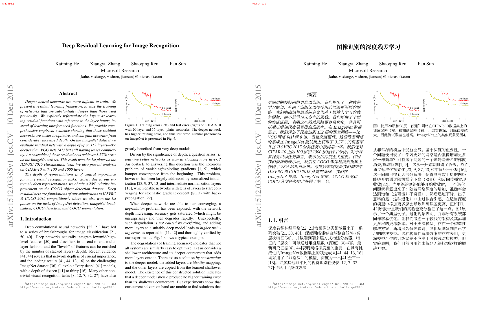

# pdf-translate

[English](README.md) | 简体中文

[](LICENSE)
[](https://www.rust-lang.org/)
[](#从源码构建)

**用 Rust 实现的、保留论文版式的 PDF 翻译器。** 单一可执行文件，不依赖 Python、BabelDOC 或外部 PDF 工具。

`pdf-translate` 把数字版学术论文的正文替换为目标语言，同时让图片、表格线、公式、页眉页脚和页面几何保持原位。它提取字形、字体、颜色、图片和坐标，重建行、段落与分栏，逐段调用任意
OpenAI 兼容接口翻译，再用内置的 Noto Serif CJK SC 子集重新排版。

当前版本提供 CLI（`inspect` 与 `translate`）、可选桌面 GUI（`gui`），以及一个调用该 CLI 的 Zotero 7+ 插件；可输出纯译文 PDF，也可输出左右并排的双语 PDF。本地 HTTP 服务仍在规划中。



*《Deep Residual Learning for Image Recognition》原始页面（左）与中文译文（右）。图片、公式、图注和页面几何保持原位。*

## 特性

- **真正的 clean 合成，而不是盖白块** — 默认 `clean` 模式只删除成功替换的原文字形，再在原位置绘制译文；图片、表格线、公式和未翻译文字仍是原始矢量内容，不会把整页渲染成截图。
- **公式保留** — 自动识别并保护展示公式；行内公式通过 `<fN>` 占位符保留为独立矢量路径，上下标和数学排版不变。
- **段落级翻译** — 支持任意 OpenAI 兼容的 chat 接口（OpenAI、DeepSeek、GLM、Qwen、Ollama、vLLM 等）；段落并发翻译，截断自动重试，结果跨进程磁盘缓存。
- **中文排版** — 将 Noto Serif CJK SC 子集嵌入输出，写入 ToUnicode，支持中文断行、标点禁则、两端对齐和逐段字号拟合。
- **单二进制** — 字体默认以 zstd 压缩后编译进可执行文件，不需要 Python 环境、外部转换器或系统字体。
- **防御性默认值** — 预检会限制输入大小和非图片流的解压大小；检测到数字签名时拒绝改写，避免静默破坏签名。

## 工作流程

```text
PDF ──▶ 提取 ──▶ 版面分析 ──▶ 翻译 ──▶ 排版 ──▶ 合成 ──▶ PDF
```

默认流程：

1. **提取**：用 [hayro](https://crates.io/crates/hayro) 收集字形、字体元数据、颜色、图片、裁剪和变换。
2. **分析**：用几何启发式识别行、段落、分栏、标题、公式、脚注、页眉页脚和参考文献。
3. **翻译**：逐段调用 `/chat/completions`，保留引文、数字、URL 以及 `<fN>` / `<b>` / `<i>` 标记。结果缓存在
   `$XDG_CACHE_HOME/pdf-translate/translations.json`（或 `~/.cache/pdf-translate/translations.json`）。
4. **排版**：用 Noto Serif CJK SC 子集断行、两端对齐、缩小字号以适应原段落，无法安全放下时回退原文。
5. **合成**：`clean` 只删除已替换的字形；`overlay` 用背景块覆盖原文后在上方绘制译文。

## 环境要求

- Rust 1.99.1+（edition 2024），从源码构建。
- 任意 OpenAI 兼容的 `/chat/completions` 接口。回环地址上的接口（Ollama、vLLM、LM Studio 等）无需 API key；远程接口需要
  `[api].api_key`、`--api-key` 或 `OPENAI_API_KEY`。
- 可提取文字的数字版 PDF。扫描件暂不支持（没有 OCR）。

## 从源码构建

```bash
cargo build --release
# 可执行文件：target/release/pdf-translate
```

默认构建会把 zstd 压缩后的 Noto Serif CJK SC Regular 编译进二进制（约 30 MB）；粗体默认使用合成粗体。需要嵌入真实粗体（约 48
MB）时：

```bash
cargo build --release --features embedded-bold-font
```

如果希望完全使用系统字体、得到更小的二进制，可以关闭默认的 `embedded-fonts` feature：

```bash
cargo build --release --no-default-features
```

这时会通过 `fontdb` 读取平台字体库：Linux 下解析 fontconfig 配置和字体目录，Windows/macOS 扫描系统字体目录。查找时优先使用系统配置的
generic serif/sans 字体，再尝试常见的 CJK 字体家族，并且候选字体必须实际包含中文字形才会被采用。存在同目录的 `*-Bold.ttc`
时会作为粗体字体使用。

无论是否嵌入字体，都可以在配置文件 `[typeset]` 中指定 `font` / `bold_font`，或用 `--font /path/to/font.ttf` 和
`--bold-font /path/to/bold.ttf` 覆盖。字体使用 SIL Open Font License 1.1，许可证见 [
`assets/fonts/LICENSE`](assets/fonts/LICENSE)。

## 快速开始

创建 `~/.config/pdf-translate/config.toml`（Linux/macOS）或 `%APPDATA%\pdf-translate\config.toml`（Windows）：

```toml
[api]
base_url = "https://api.openai.com/v1"
# api_key = "sk-..."          # 或者设置 OPENAI_API_KEY
model = "gpt-4o-mini"
max_tokens = 4096
temperature = 0.2
timeout_secs = 180

[translation]
target_lang = "zh-CN"
concurrency = 6

[typeset]
# font = "/path/to/NotoSerifCJK-Regular.ttc"
# bold_font = "/path/to/NotoSerifCJK-Bold.ttc"
min_scale = 0.72
max_expand = 1.45
line_height = 1.22
```

然后翻译一篇论文：

```bash
pdf-translate translate paper.pdf
# 在输入文件旁生成 paper.zh.pdf
```

也可以临时用命令行覆盖 API 设置：

```bash
pdf-translate translate paper.pdf \
  --api-base https://api.deepseek.com/v1 \
  --api-key "$DEEPSEEK_API_KEY" \
  --model deepseek-chat \
  -o paper.zh.pdf
```

不调用网络、快速验证排版：

```bash
pdf-translate translate paper.pdf --fake -o paper.preview.pdf
```

只翻译部分页面：

```bash
pdf-translate translate paper.pdf --pages 2-5,8 -o paper.zh.pdf
```

导出解析结果：

```bash
pdf-translate inspect paper.pdf --pages 1-2 -o layout.json
```

JSON 中包含每页的行、段落、bbox、字体、公式标记和 `protected` 标记，方便调试版面。省略 `-o` 会输出到 stdout；加 `--compact`
输出紧凑 JSON。

## 配置

与具体文档无关的设置放在全局 TOML 配置文件中：

- Linux/macOS：`$XDG_CONFIG_HOME/pdf-translate/config.toml`，默认 `~/.config/pdf-translate/config.toml`
- Windows：`%APPDATA%\pdf-translate\config.toml`

### 桌面 GUI

构建可选原生 GUI，并在启动时直接打开 PDF：

```bash
cargo build --release --features gui
target/release/pdf-translate gui paper.pdf
```

GUI 支持拖入 PDF、常用翻译选项、实时进度、取消、原文/译文页面预览，以及打开生成的 PDF。设置与 CLI 共用同一份 TOML 配置；外观可选择跟随系统、浅色或深色，保存设置后会记住主题。GUI 使用最新版 `eframe`/`egui`、`rfd` 和 `open`，运行时需要平台常规的桌面图形库。

也可以用 `--config PATH` 或环境变量 `PDF_TRANSLATE_CONFIG` 指定另一个文件。默认位置的文件不存在时使用内置默认值；显式指定的文件不存在会报错。未知配置项会被拒绝。

优先级为：命令行参数 > 配置文件 > `OPENAI_BASE_URL` / `OPENAI_API_KEY` / `OPENAI_MODEL` 环境变量 > 内置默认值。

输入/输出路径、页范围、overlay 模式、注释处理等与具体文档相关的选项由 CLI 或 GUI 按任务提供。

## 命令行

```text
pdf-translate inspect <input.pdf> [--pages 1-] [-o layout.json] [--compact]
pdf-translate translate <input.pdf> [-o output.pdf] [options]
pdf-translate gui [input.pdf]  # 需要 `gui` feature
```

| 参数                     | 说明                                    |
|--------------------------|-----------------------------------------|
| `-o, --output PATH`      | 输出 PDF（默认：`<输入文件名>.zh.pdf`） |
| `--pages 1-3,5`          | 只处理指定页面（1-based，默认 `1-`）    |
| `--limit N`              | 只翻译前 N 段，便于调试                 |
| `--overlay`              | 使用 overlay 合成；默认 clean           |
| `--bilingual`            | 输出原文/译文左右并排的双语 PDF         |
| `--no-cover`             | overlay 模式不画背景块                  |
| `--keep-annotations`     | 保留译文页上的链接/标注                 |
| `--translate-references` | 连参考文献也翻译（默认跳过）            |
| `--dump-layout PATH`     | 导出布局和译文 JSON                     |
| `--fake`                 | 不调用网络，给每段加 `[译]` 前缀        |
| `--debug-boxes`          | 绘制段落 bbox 便于调试                  |

以下参数用于覆盖配置文件中的全局默认值：`--target-lang`、`--concurrency`、`--font`、`--bold-font`、`--min-scale`、
`--max-expand`、`--line-height`、`--api-base`、`--api-key`、`--model`。

输入、输出 PDF 和布局 JSON 需要指向不同的文件。真实模型的缓存键包含服务地址、模型、目标语言和原文；旧版本无法确认是否截断的模型译文会重新请求。

## clean 与 overlay

默认使用 `clean` 模式：

- 从内容流中删除成功替换的文字字形；
- 清除相关 `ActualText` / `Alt`，并清理失去引用的旧内容流和 Form XObject；
- 图表、表格线、参考文献、受保护的公式及无法安全排版的段落仍保留原始矢量内容；
- **不会**嵌入整页原文快照；
- 无法安全改写页面时直接报错，不会静默降级为 overlay。

`--overlay` 保留原内容流，用背景块覆盖原文后再绘制译文。覆盖层下面的原文仍然存在，因此适合扫描件或无法 clean 改写的页面；
`--no-cover` 可以关闭背景块。

默认会移除译文页上的链接（Link）注释，避免链接框停留在译文上；表单、评论、遮盖等其它注释会保留。需要保留链接时加
`--keep-annotations`。

两种模式都不是针对元数据、附件、注释等所有 PDF 通道的通用脱敏工具。

## 双语并排

`--bilingual` 会输出新的 PDF：每页左侧是原文页，右侧是译文页，适合在 Zotero 或任意 PDF 阅读器中对照阅读。原文页上的注释不会复制到合并后的 PDF；支持 `/Rotate` 为 0/90/180/270 的页面及非零 CropBox 原点。Zotero 插件默认启用该模式，导入后直接以单个并排文档打开。

```bash
pdf-translate translate paper.pdf --bilingual -o paper.bilingual.pdf
```

## 能力与限制

已实现：

- 数字版 PDF 的文字提取、行/段落/分栏识别和阅读顺序；
- 公式字体/数学符号识别；展示公式段落默认保护，不翻译；
- 行内公式通过 `<fN>` 占位符 + 独立字形矢量路径保留原字形、上下标和排版；模型不保留占位符时该段回退为原文；
- 脚注和 URL 保留原矢量文本；正文中的 URL 通过 `<fN>` 独立矢量路径保留原字形；
- 参考文献默认跳过，可用 `--translate-references` 开启；
- 通过 PDF 字体名识别粗体/斜体，翻译时用 `<b>` / `<i>` 标记传递；模型丢失标记时自动退回段落级样式；
- 段落级并发翻译、截断重试、跨进程磁盘缓存；
- 粗体/斜体样式保留（启用或可用时使用真实 CJK 粗体，斜体为合成倾斜）；
- CJK 字体子集嵌入、ToUnicode、中文断行、标点禁则和两端对齐基础；
- 按字形执行 clean 合成，共享 Form XObject 按调用分别改写，混合文本保留原位置；
- `--bilingual` 输出左右并排的双语 PDF，原文页和译文页都作为 Form XObject 组合；
- overlay 合成：隔离原内容流的变换、裁剪和文字状态后绘制译文；
- 按 `/ActualText` 提取替代文本；忽略完全裁剪、透明或不可见的文字，对局部裁剪、半透明、软蒙版等不能独立替换的文字保留原文；
- 页面 `/Rotate` 为 0/90/180/270 时在旋转后的坐标系中分析和排版，支持非零 CropBox 原点；
- 动态分配字体和公式资源名；保留同一字形对应不同 Unicode 字符的映射，并按 PDF 单位写入字体度量；
- 字体缺字、译文达到最小字号仍然超宽/超高时警告并保留该段原文；所有段落均无法安全排版时不生成输出；
- 预检会检查输入大小和非图片流的解压大小（默认限制：输入 512 MiB、单流 64 MiB、累计流 256 MiB）。图片流交给渲染器按需解码，不做预解压或尺寸限制。这些限制不构成对任意恶意
  PDF 的完整沙箱。

尚未实现：

- 本地 HTTP 服务、段落级 Zotero 覆盖层；
- OCR（扫描件目前只能用 overlay 模式保留原图，不做文字识别）；
- 表格文字翻译（表格区域通常被保护）；
- 链接矩形随译文移动；
- 图内/表内标签翻译；
- 行内公式路径不提供文字选择；
- CJK 真实斜体（目前为合成倾斜）；
- 密码保护 PDF 的解密、竖排文字、复杂文字塑形和任意角度旋转文字的翻译；
- PDF/A、PDF/X、PDF/UA 和完整 PDF 2.0 一致性验证；原有结构树、书签和表单不随译文重新排版；
- 数字签名保留：检测到签名后拒绝改写，需使用未签名副本。

上述能力面向常见数字版论文，不代表完整覆盖 PDF 标准。

## 开发

```bash
cargo fmt
cargo test
cargo clippy --all-targets
cargo test --features gui
cargo clippy --all-targets --features gui
```

模块结构：

```text
src/
  main.rs        CLI 与 GUI 入口
  cli.rs         clap 参数
  config.rs      全局 TOML 配置
  workflow.rs    共享翻译任务、进度与取消
  gui.rs         可选原生桌面界面
  gui/
    preview.rs   使用 hayro 渲染 GUI 页面预览
  model.rs       页/行/段/字形数据模型
  markup.rs      公式占位符、字面文本和样式标记
  output.rs      输出文件身份检查与原子写入
  pages.rs       页范围解析
  pdf.rs         PDF 模块入口
  pdf/
    extract.rs   hayro Device：提取字形、图片、颜色
    content.rs   页面内容流与资源读取
    preflight.rs 输入和解压资源限制
    geometry.rs  页面旋转坐标变换
    font.rs      字体加载、CJK 子集、ToUnicode
    rewrite.rs   按字形来源删除原文、隔离共享 Form、公式路径与旧对象清理
    rewrite/     内容流插桩、源字形与绘制操作匹配
    writer.rs    页面合成（clean/overlay）
    regression.rs 合成、字体、裁剪及边界条件回归测试
  layout.rs      布局分析入口
  layout/        行聚类与分栏、段落分类与保护、行内公式与样式
  translate.rs   翻译任务调度与结果回填
  translate/     OpenAI 兼容客户端、翻译缓存
  typeset.rs     断行、字号拟合、中文排版
  text.rs        CJK 字符判定等共享文本工具
zotero/
  manifest.json  Zotero 7+ 插件清单
  bootstrap.js   插件启动/关闭
  content/       阅读器按钮、菜单、子进程、设置页
  locale/        Fluent 文案（en-US、zh-CN）
  test/          纯函数的 Node 测试
```

## Zotero 插件

Zotero 集成是 CLI 外面的一层薄插件：在 PDF 阅读器工具栏加入「翻译」按钮，在条目右键菜单加入「翻译 PDF」，对选中的附件运行
`pdf-translate`，用进度窗口展示各阶段，并导入一个单独的双语对照 PDF 子附件。再次点击时会优先打开已有的双语附件或缓存，
而不是重新翻译。

```bash
cargo build --release
mkdir -p ~/.local/bin
cp target/release/pdf-translate ~/.local/bin/
./zotero/build.sh
# 在「工具 -> 插件」中安装 zotero/dist/pdf-translate-zotero-<version>.xpi
```

设置、缓存位置和开发说明见 [`zotero/README.md`](zotero/README.md)。本地 HTTP/SSE 服务和段落级覆盖层仍待实现。

## 文档

- [设计与实现方案](docs/DESIGN.md) — 架构、数据模型、算法选择和路线图。
- 运行 `pdf-translate --help` 或 `pdf-translate translate --help` 查看自动生成的命令行参考。

## 许可证

代码目前为 MIT，见 [LICENSE](LICENSE)。

第三方组件：hayro（Apache-2.0/MIT）、lopdf（MIT）、subsetter 与 pdf-writer（MIT/Apache-2.0）、Noto CJK 字体（OFL-1.1）。设计文档讨论了与
BabelDOC（AGPL-3.0）和 DocLayout-YOLO（AGPL-3.0）的可选集成；它们不属于当前构建。移植其代码或分发其模型前，需要重新评估 AGPL
义务。
